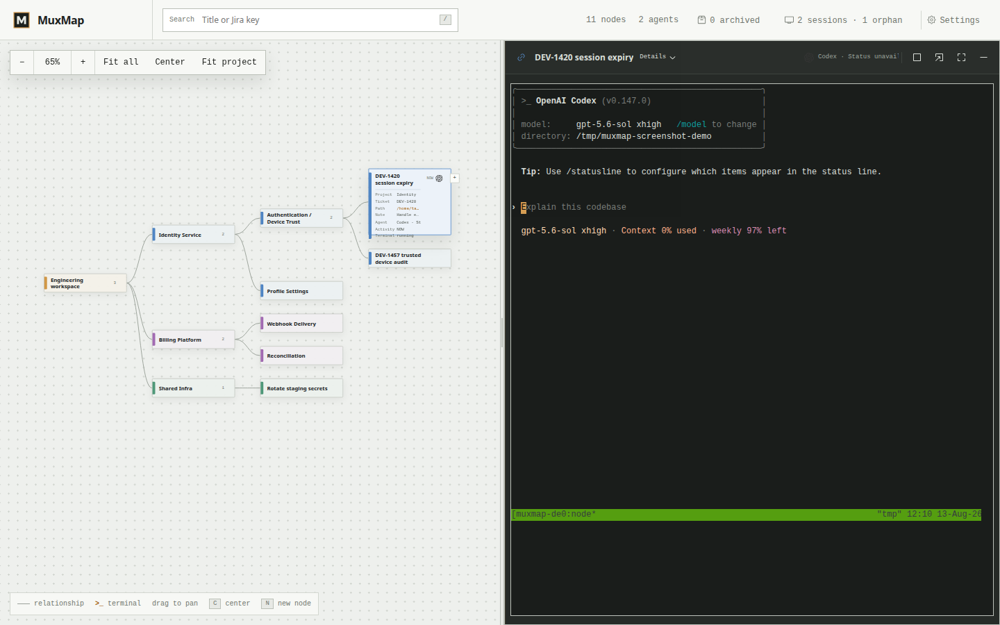

# MuxMap

[](https://github.com/syntaxskills/muxmap/actions/workflows/ci.yml)

**A mindmap for your Claude Code and Codex terminals.**

Running several coding-agent sessions across repos and tasks? MuxMap gives each terminal a place on a map, so you can see what it belongs to, spot sessions that need attention, and get back to the right work.

Group work by repo, feature, or ticket. Attach a persistent terminal to any node. Keep the map visible beside your terminal, and return to the same running session after closing or refreshing the browser.



*Example workspace with synthetic data. [More screenshots](docs/SCREENSHOTS.md).*

[Quick start](#quick-start) · [Your first session](#your-first-session) · [Agent status](#agent-status-optional) · [Persistence](#how-persistence-works)

## Why use it?

- **Remember what each terminal is for.** Put Claude Code, Codex, Pi, ordinary shells, and SSH sessions next to their repo, task, notes, and links.
- **See what needs your attention.** Optional agent hooks show working, completed, and waiting-for-input states, with in-page or system notifications.
- **Pick up where you left off.** tmux on macOS/Linux or Zellij on Windows keeps terminals running when the browser disconnects.
- **Keep context with the work.** Save notes, opened files, and Jira/GitHub/GitLab/Lark links on each node.
- **Clean up deliberately.** Find orphaned MuxMap sessions, adopt them into the map, or stop them. Archive finished branches when you're ready to stop their terminals.

MuxMap runs locally and stores workspace data in SQLite. Bring your own installed coding-agent CLI and its usual authentication; MuxMap doesn't include an agent or model subscription.

## Quick start

### Prerequisites

- **Git and Node.js with npm.** Use a current Node.js 22.x or 24.x release. Node 22 must be **22.13 or newer** because the server uses [built-in SQLite](https://nodejs.org/api/sqlite.html).
- **A terminal multiplexer on your PATH:** `tmux` on macOS/Linux, or **Zellij 0.44.3+** on Windows.
- **Native build tools for `node-pty`:** Python and a C/C++ toolchain. See the [platform prerequisites](https://github.com/microsoft/node-pty#dependencies) if installation fails.
- **Optional:** `claude`, `codex`, or `pi`, installed and authenticated if you want to run that agent. Ordinary terminals work without an agent.

### Install and run

```bash
git clone https://github.com/syntaxskills/muxmap.git
cd muxmap
npm ci
npm run dev
```

Open the **Local URL printed by Vite**, usually **<http://localhost:5173>**. Keep the command running while you use MuxMap. Development mode starts both the UI and the local backend on port `4782`.

To run the built app instead, stop development mode with `Ctrl+C`, then run:

```bash
npm run build
npm start
```

Open **<http://127.0.0.1:4782>**. This still runs on your computer; no deployment is required.

### Your first session

1. Select the workspace root and choose **+ Add child node**. Name it for something you're working on, such as `Fix login redirect`.
2. In the node's **Context**, set **Repository path** to an existing local directory. The initial workspace contains example nodes and paths; replace those paths before attaching a terminal to them.
3. Click **Attach terminal**. Run `claude`, `codex`, or your usual shell command in that terminal.
4. Add another node for a second task. Select either node to return to its terminal; dock, float, or full-screen the terminal to suit your workflow.
5. Refresh the page and reopen the node. Its terminal reattaches while the underlying tmux/Zellij session is still running.

Add [agent hooks](#agent-status-optional) when you're ready to see which sessions are working or waiting for you.

## Agent status (optional)

From the cloned MuxMap directory:

```bash
npm run hooks:install
npm run hooks:status
```

The installer detects CLIs on your PATH and updates their local configuration:

- Codex: `~/.codex/hooks.json`
- Claude Code: `~/.claude/settings.json`
- Pi: `~/.pi/agent/extensions/muxmap-status.ts`

It preserves unrelated Codex/Claude hooks. Start an agent in a MuxMap terminal after installation, then enable notifications in **Settings** if you want alerts. Hooks identify the current terminal; they don't import all of your existing agent sessions. Plain terminals without a locator do nothing, and ordinary tmux/Zellij sessions are ignored.

After pulling hook changes, or moving the MuxMap checkout, run:

```bash
npm run hooks:update
npm run hooks:status
```

**Status is a useful signal, not a guarantee that a task is finished.** It depends on the events your agent emits. Codex input alerts wait five seconds before becoming eligible for delivery on the next workspace refresh; slow automatic approvals can still trigger an alert. See [hook behavior](docs/AGENT-HOOKS.md) and the [upstream Codex report](https://github.com/openai/codex/issues/28833).

## How persistence works

- **The map and notes:** Stored in `.muxmap/muxmap.db` by default, relative to the directory where MuxMap starts. Set `MUXMAP_DATA_DIR` to choose another data directory. Keep this data when updating the app.
- **Live terminals:** Owned by tmux or Zellij. Closing the browser doesn't stop them. A machine reboot or a stopped runtime does end the live shell; SQLite doesn't preserve arbitrary process state.
- **Agent recovery:** When supported resume metadata is available, MuxMap can resume a saved agent conversation. This is separate from keeping a process alive.
- **Archive:** Archiving a node or branch preserves its map context but stops its live terminal sessions. Restoring the node doesn't restore the old processes.
- **Automatic suspension:** The optional `terminal.autoSuspend` setting can stop quiet runtimes when `terminal.maxActiveSessions` is exceeded. It retains session metadata, not arbitrary shell state.
- **Existing terminals:** The Sessions panel manages `muxmap*` runtimes, including orphans. Unrelated tmux/Zellij sessions aren't automatically adopted.

Your coding agents and commands retain their usual filesystem, network, and provider access. Running MuxMap locally doesn't make an external agent service offline.

## Troubleshooting

**Installation fails while building `node-pty`**

Check `node --version` and install the [native build prerequisites](https://github.com/microsoft/node-pty#dependencies) for your OS, then rerun `npm ci`.

**The map loads, but a terminal won't open**

Confirm `tmux -V` on macOS/Linux or `zellij --version` on Windows works in the shell that starts MuxMap. Check that the node's Repository path exists. Run `npm run doctor` before starting the app to check the port and access configuration; it also checks Zellij on Windows.

If macOS/Linux reports `posix_spawnp failed`, check the file descriptor limit:

```bash
ulimit -n
```

`256` is too low for terminal-heavy use. If your shell permits it, raise the limit and restart MuxMap from that same shell:

```bash
ulimit -n 4096
npm run dev
```

**An agent's status is missing or stale**

Run `npm run hooks:status`, then `npm run hooks:update` if needed. Make sure the agent was launched inside a MuxMap-managed terminal. See [Agent hooks](docs/AGENT-HOOKS.md) for event and recovery details.

## Access and security

MuxMap provides **real terminal control** with the permissions of the account running the server. It starts in local mode, bound to `127.0.0.1`. Keep it local unless another device needs access; don't expose it to an untrusted network.

| `MUXMAP_ACCESS` | Use case | Authentication |
| --- | --- | --- |
| `local` (default) | Same computer | Local session cookie |
| `lan` | Trusted local network | Basic Auth using `MUXMAP_TOKEN` |
| `tailscale` | Tailnet access | Basic Auth using `MUXMAP_TOKEN` |

Run `npm run doctor` before starting a network-accessible server. In Basic Auth modes, the username is `muxmap` and the password is your `MUXMAP_TOKEN`. See [Windows LAN/Tailscale setup](docs/WINDOWS-NETWORK.md) and the [security policy](SECURITY.md).

`MUXMAP_AUTH=none` explicitly disables the password in LAN/Tailscale mode, giving clients allowed by your network and firewall terminal control. Use this only when you understand and trust that access boundary.

File previews and terminal starting directories can use any path accessible to the MuxMap process by default. To restrict them, set `MUXMAP_ALLOWED_ROOTS` to comma-separated directories. The first root becomes the default working directory. **This setting does not sandbox commands run inside terminals.**

## More features

### File previews and notes

Terminal file links open in a browser preview and are saved in the node's **Notes & artifacts** stream. Markdown supports Mermaid diagrams; HTML opens in a sandboxed preview. The header can copy a path or content.

Under **Open in…**, Zed opens on the browser's computer via a `zed://file` link, so the file must be accessible there. VS Code uses the `code` CLI on the MuxMap server. Relative paths use the terminal's working directory, a supplied `cwd`, or MuxMap's working directory when neither is available.

Use **Upload files** beside the terminal input to choose images or other files on desktop or mobile, or paste images directly into the input. Each file can be up to 20 MB. Uploads are saved under the MuxMap data directory's `attachments` folder with unique filenames; their absolute paths are inserted into your draft for the agent to read when you press **Send**. Image previews and a **Copy path** button appear above the input. Files remain available after sending or restarting MuxMap. Agents must have access to that directory; an agent running over SSH or in an isolated container may need a separate transfer or mount.

### Agent channels and MCP

Manually connect two terminal-backed nodes to create a bounded agent-message channel. The map shows the relationship; the bundled MCP adapter lets agents read and send messages, check quotas, and add or read node notes.

Configure an MCP client to run the Node entry directly, using an absolute path to your checkout if the client starts elsewhere:

```bash
node --experimental-strip-types /absolute/path/to/muxmap/server/mcp-adapter.ts
```

Set `MUXMAP_URL` (default `http://127.0.0.1:4782`), `MUXMAP_TOKEN` when Basic Auth is enabled, `MUXMAP_NODE_ID` to default to the current node, and optionally `MUXMAP_WORKSPACE_ID` (default `default`). New tmux sessions created by MuxMap carry `MUXMAP_NODE_ID`, `MUXMAP_SESSION_ID`, and `MUXMAP_URL`; existing sessions aren't changed retroactively.

For a manual smoke test from the checkout, use `npm run --silent mcp`. Bare `npm run mcp` writes an npm banner to stdout and is unsuitable as an MCP client command. See [Architecture](docs/ARCHITECTURE.md#agent-channels) for tools, quotas, and APIs.

### Workspace settings

Open **Settings** from the top bar to change appearance, terminal behavior, notifications, and more. Settings are editable through the UI or the nested JSON tab; legacy dotted keys are also accepted. **Settings → About** shows the build version and checks GitHub for updates against `main`.

The terminal command box keeps its own per-session input history in MuxMap. It doesn't write those entries into your shell's history. Older lifecycle-step tools remain available under **Settings → Lifecycle**.

## Development and feedback

```bash
npm test
npm run lint
npm run build
npm run doctor
```

Run Doctor with the server stopped, since it checks whether the port is available. See [Contributing](CONTRIBUTING.md) and [Acceptance coverage](docs/ACCEPTANCE.md).

If you try MuxMap with several agent sessions, [open an issue](https://github.com/syntaxskills/muxmap/issues) with what worked or where you got stuck. For bugs, include your OS, Node version, terminal backend, and steps to reproduce; remove private paths, tokens, and terminal content. If it helps your workflow, a GitHub star helps other developers find it.

[Architecture](docs/ARCHITECTURE.md) · [Agent hooks](docs/AGENT-HOOKS.md) · [Screenshots](docs/SCREENSHOTS.md) · [Changelog](CHANGELOG.md) · [MIT License](LICENSE)
